<div align="center">

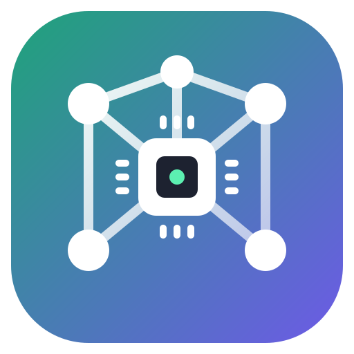

# AI Infrastructure Tycoon

**Pour concrete. Buy GPUs. Set them on fire (thermally). Conquer Earth (economically).**

A free, open-source parody management game about running an AI company from an empty field
to a planet-sized compute empire, made for fun, by and for the community.

[](https://github.com/Phantom-Con-Artist/Ai-Infrastructure-Tycoon/releases)
[](https://github.com/Phantom-Con-Artist/Ai-Infrastructure-Tycoon/actions)
[](LICENSE)
[](CONTRIBUTING.md)
[](DISCLAIMER.md)
<br/>
[](https://www.electronjs.org/)
[](https://react.dev/)
[](https://threejs.org/)
[](https://www.typescriptlang.org/)
[](https://www.remotion.dev/)
[](https://www.blender.org/)
[](https://claude.com/claude-code)

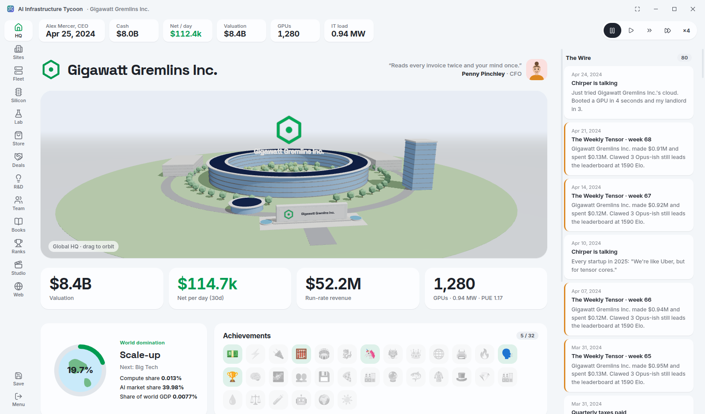

</div>

---

## What is this?

You start with $40M, a CEO title and absolutely nothing else. No land, no servers, no idea.

From there you buy land, build data halls, and drag racks, power units and cooling onto the floor. Your servers come from parody chipmakers or from chips you design yourself. You rent them out, train models, launch products and hold keynotes with suspiciously vague bar charts.
The rivals are Qooqle, Nicosoft, Ratthropic, OpenAye, Nvidious, Advanced Micro Dudes and friends.
None of them are real, and all of them are trying to beat you.

It never ends. There's always a bigger node, a hotter chip, a hungrier model.
The only lose condition is running out of money for 30 days.

> [!NOTE]
> This is a **beta** and a **community parody project**. Expect rough balance, odd bugs, and
> a lot of jokes about leather jackets. Ideas and pull requests are very welcome.

## Screenshots

<table>
<tr>
<td width="50%">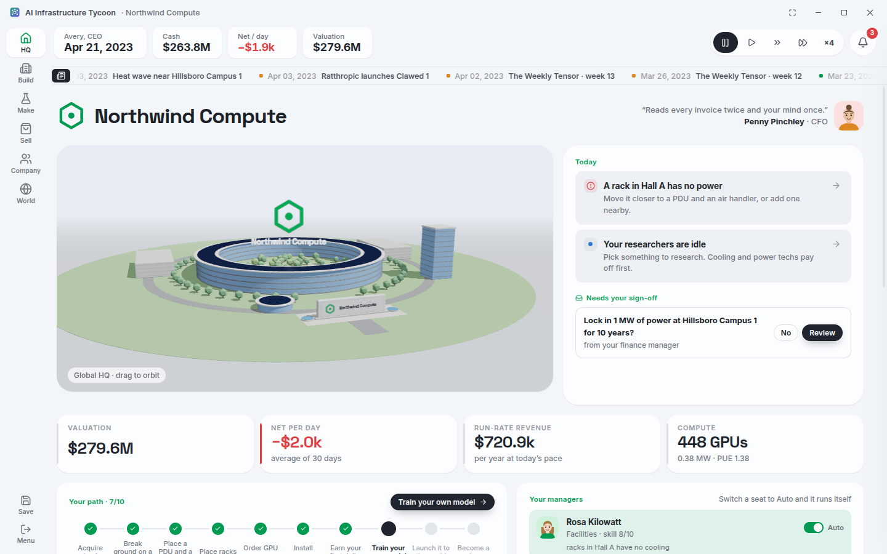<br/><sub><b>HQ tells you what matters today.</b> Up to three next steps, requests from your managers, and your path so far.</sub></td>
<td width="50%">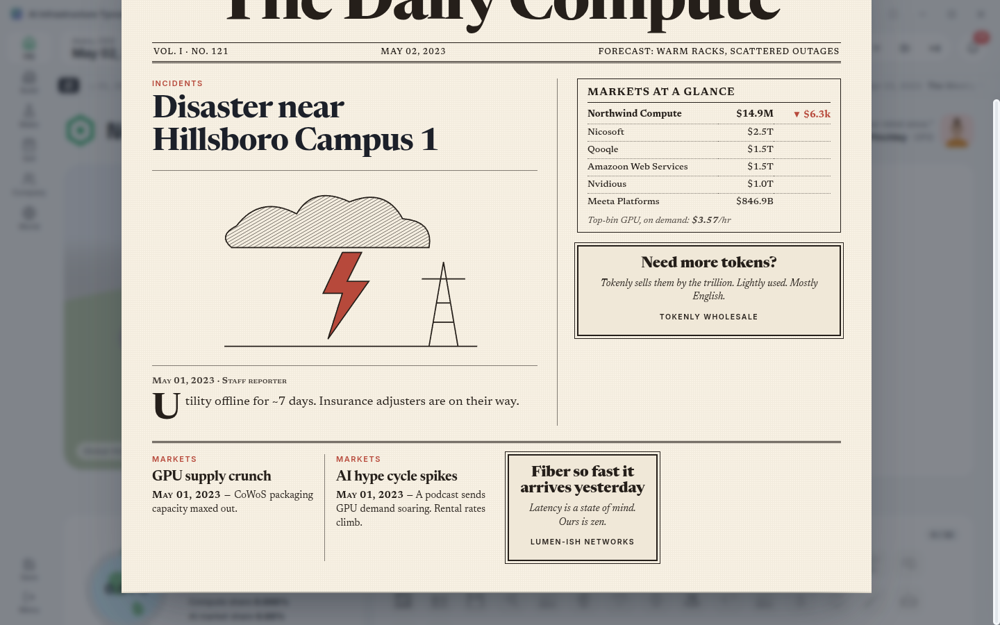<br/><sub><b>The Daily Compute.</b> A morning paper every game day, built from what actually happened.</sub></td>
</tr>
<tr>
<td width="50%">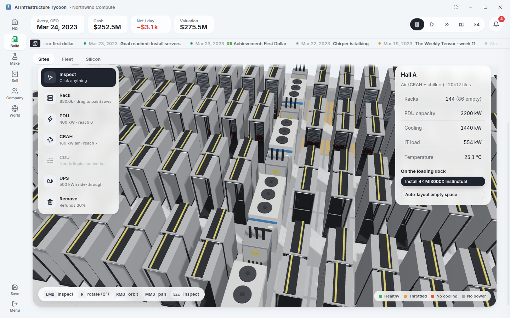<br/><sub><b>The hall editor.</b> Every rack needs a PDU and a cooler within reach. Overload them and things get warm.</sub></td>
<td width="50%">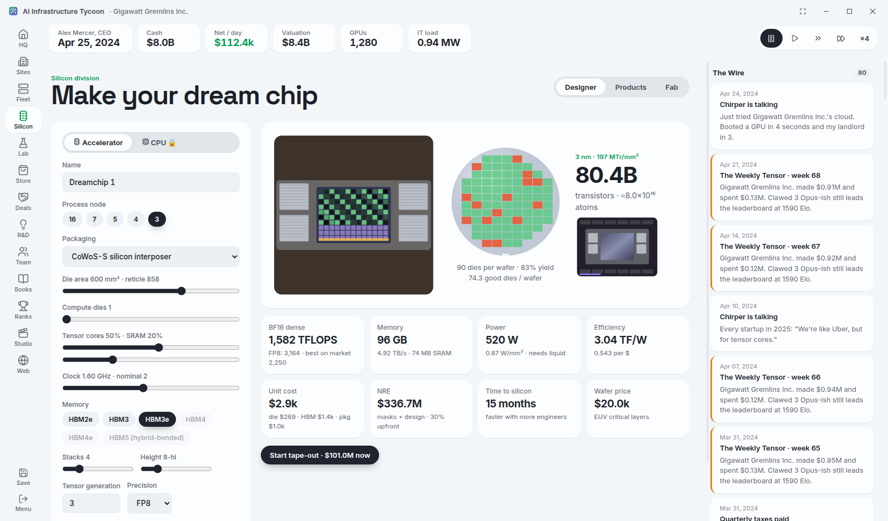<br/><sub><b>Make your own chip.</b> Pick a node and a die size, then watch yield fall off a cliff.</sub></td>
</tr>
<tr>
<td>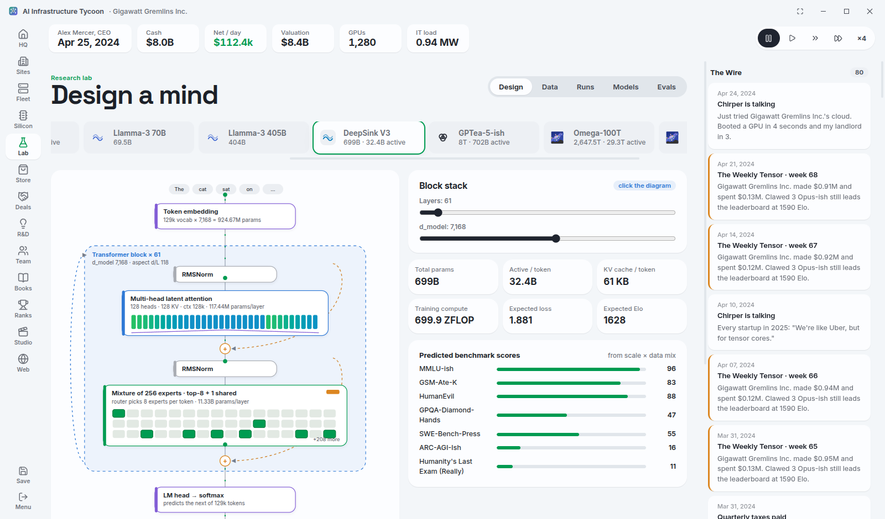<br/><sub><b>Design a model.</b> Click the diagram. Add experts. Regret the KV cache.</sub></td>
<td>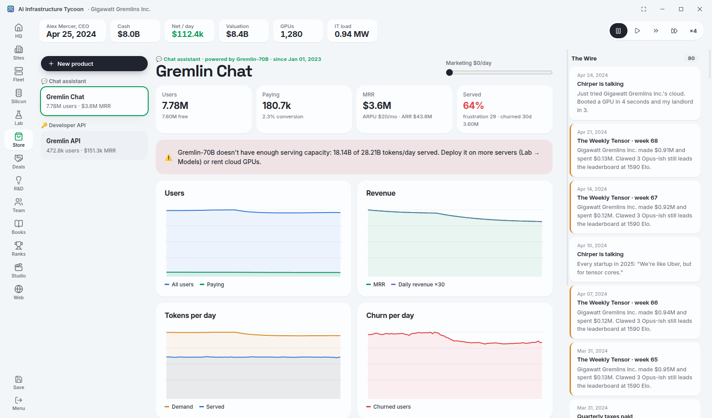<br/><sub><b>Ship products.</b> Free, Plus, Pro. Users churn when your GPUs can't keep up.</sub></td>
</tr>
<tr>
<td>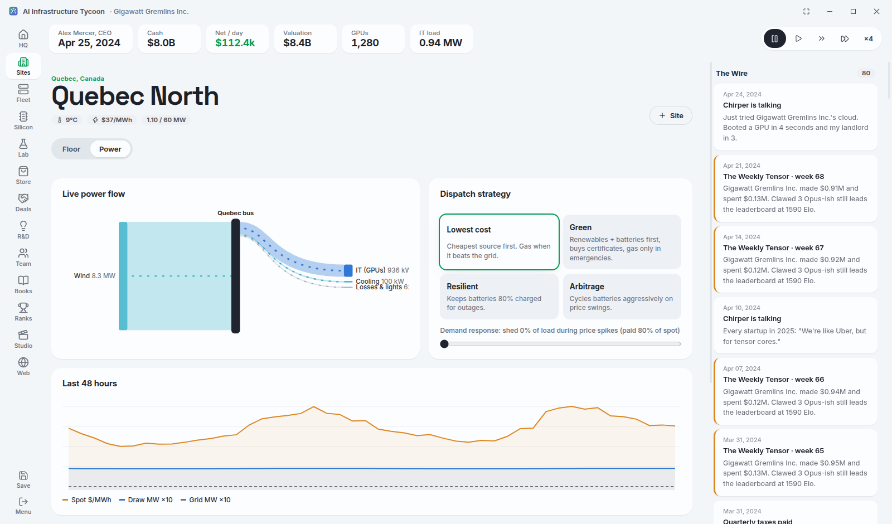<br/><sub><b>Keep the lights on.</b> Batteries, PPAs, demand response, and Texas.</sub></td>
<td>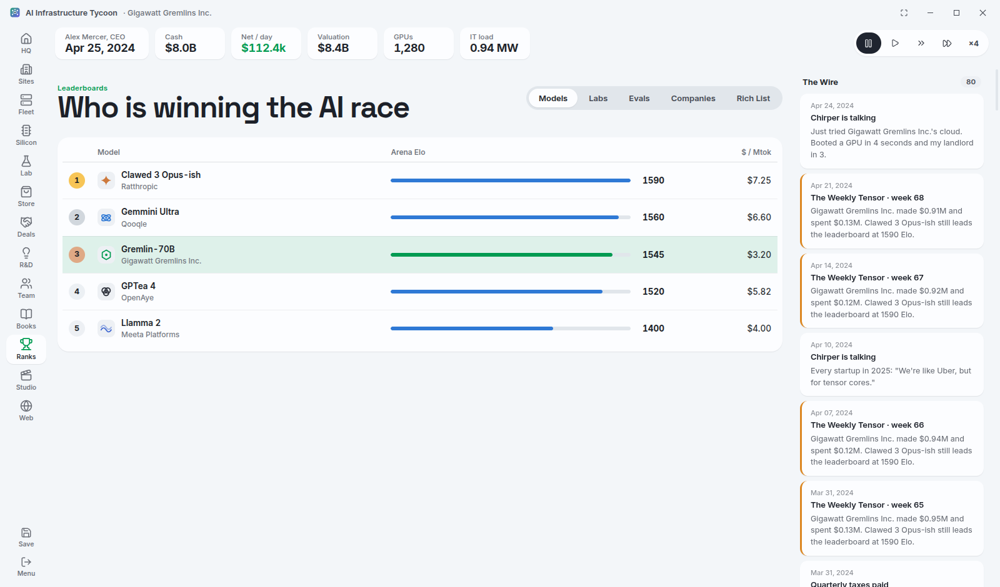<br/><sub><b>Leaderboards.</b> Models, labs, benchmarks, companies, and the rich list you are trying to top.</sub></td>
</tr>
<tr>
<td>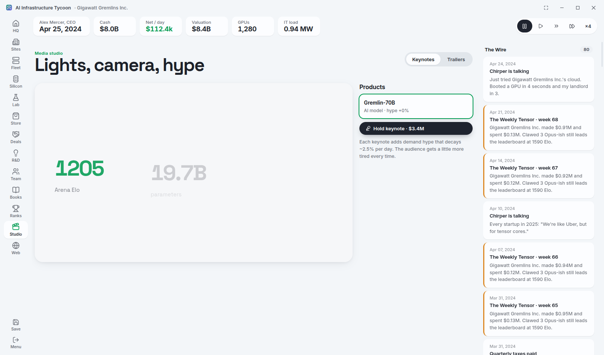<br/><sub><b>Keynotes.</b> Generated with Remotion from your actual products. Hype is a resource.</sub></td>
<td>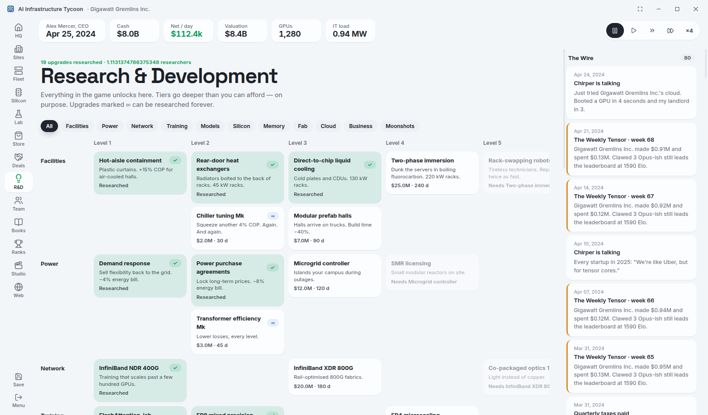<br/><sub><b>R&D.</b> Eleven branches and nine levels, with upgrades marked ∞ you can research forever.</sub></td>
</tr>
</table>

<details>
<summary>More screenshots</summary>

| | |
|---|---|
| 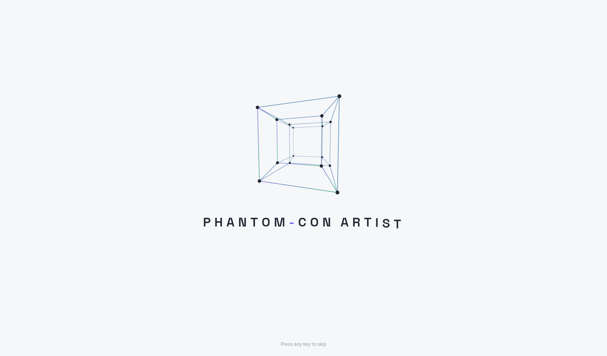 | 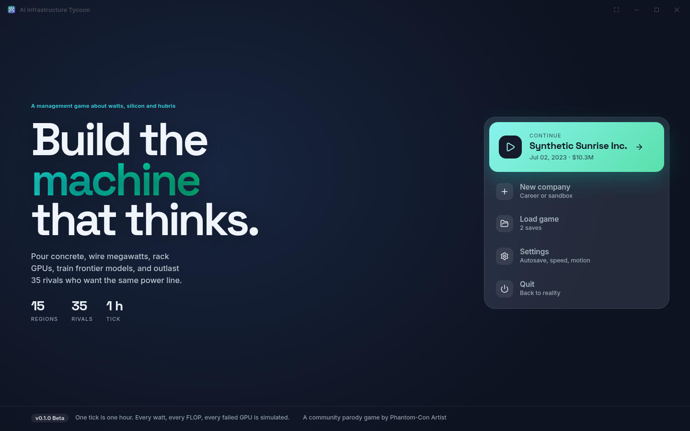 |
| 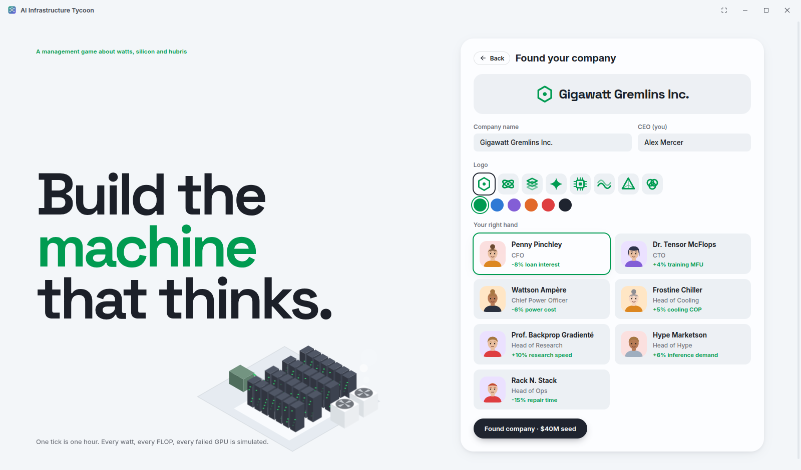 | 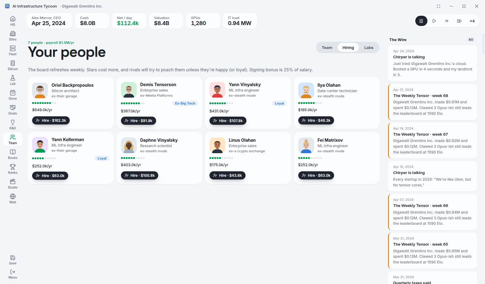 |
| 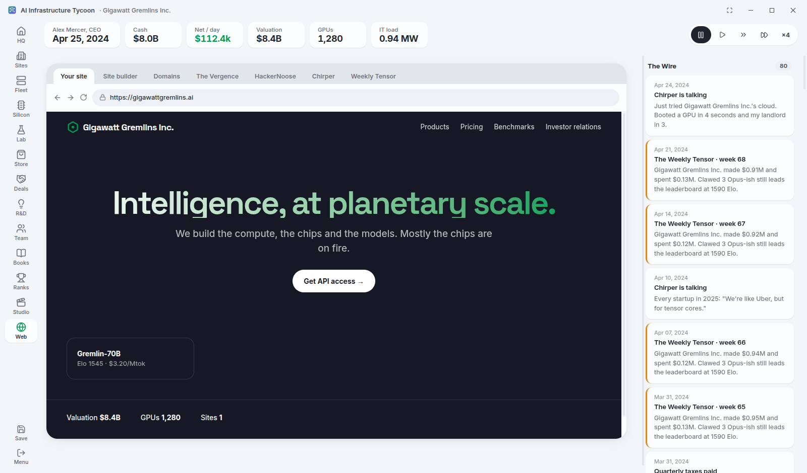 | |

</details>

## What you can do

| | |
|---|---|
| 🏗️ **Build** | Pick from 9 regions with real-ish power prices, climates and permit delays. Lay out halls tile by tile in 3D. |
| ⚡ **Power** | Utility feeds, solar, wind, gas, batteries, geothermal and eventually small reactors. Choose a dispatch strategy and sign PPAs. |
| ❄️ **Cool** | Air, rear-door, direct-to-chip, immersion. Air can't handle a Blackwall-class rack, and physics will remind you. |
| 🔩 **Silicon** | Design GPUs and CPUs from process node to HBM stack. Tape out, buy wafers or build your own fab with EUV scanners, then sell chips. |
| 🧠 **Models** | Real transformer maths (GQA, MLA, mixture-of-experts), a dataset market with "legal risk", and benchmark scores that depend on your data mix. |
| 🛍️ **Products** | Chat apps, coding agents, an API platform with keys and rate limits, and enterprise seats. You design the plans. |
| ☁️ **Cloud** | Rent out GPU and CPU servers on-demand, reserved or spot, or rent compute yourself when you're short. |
| 👥 **People** | Hire named weirdos with traits, keep them happy, and watch rivals poach your best ones. |
| 🏆 **Rivals** | Leaderboards, acquisitions (if regulators let you), an IPO, a rich list, and 32 achievements. |
| 🧭 **Guidance** | HQ suggests the next few things worth doing. Hire managers for facilities, sales, people, finance and research and let them run on autopilot; they ask before anything you can't undo. |
| 🛡️ **Safety net** | Anything irreversible asks first (hold to confirm), big purchases show your cash afterwards, and small edits can be undone for five seconds. |
| 📰 **News** | A headline ticker, a news drawer you can filter, and The Daily Compute every morning. |
| 🧪 **Sandbox** | Your own rules: unlimited cash, no bankruptcy, six difficulty sliders and a developer panel. |
| 🎬 **Hype** | Keynotes and one-click trailers made with Remotion, plus an in-game web with a site builder and a domain registrar. |

## Getting started

You need [Node.js](https://nodejs.org/) 20 or newer and a computer that doesn't mind a little WebGL.

```bash
git clone https://github.com/Phantom-Con-Artist/Ai-Infrastructure-Tycoon.git
cd Ai-Infrastructure-Tycoon
npm install
npm run dev        # launches the game in Electron
```

Other handy scripts:

```bash
npm run web        # play in a browser instead (saves go to localStorage)
npm test           # run the simulation tests
npm run typecheck  # make TypeScript happy
npm run dist       # package an installer (AppImage / NSIS / DMG)
```

> [!TIP]
> Launching from a VS Code terminal? VS Code sets `ELECTRON_RUN_AS_NODE`, which stops Electron
> from opening a window. Use `env -u ELECTRON_RUN_AS_NODE npm run dev` instead.

## How to play (the 30-second version)

0. Not sure what to do? **HQ** always lists the next steps — click one to jump there.
1. **Build → Sites** → buy land somewhere with cheap power and cold air.
2. Break ground on a hall, then place **PDUs**, **coolers** and **racks** (drag to paint rows).
3. **Build → Fleet** → order servers, wait for the truck, install them from the loading dock.
4. Rent them out, or sign a training contract in **Deals**.
5. Press play. Watch the money. Watch the temperature. Panic appropriately.
6. Later: research your way into chips, models, products, fabs and, eventually, the Sun.

Controls: `Space` pauses, `1`–`4` set the speed, and `F11` toggles fullscreen. In a Sandbox game, `` ` `` opens the developer panel. In the hall editor, `R` rotates, `X` removes and `Esc` goes back to inspect.

## Under the hood

The simulation is plain, deterministic TypeScript in [`src/sim`](src/sim). It advances one hour per tick, can be seeded, and serializes straight to a save file.
It has no UI code in it, so it's easy to test and easy to mod.

Some numbers are calibrated against public reporting so the game *feels* right:

- A chip configured like an H100 comes out near 80B transistors, ~990 dense BF16 TFLOPS and ~700 W.
- Parameter counts for the Llamma / Mixtrial / DeepSink templates match their published sizes.
- About 5% of chat users pay, churn runs around 5–7% a month, and API rate limits follow cumulative-spend tiers.

All of it is still a game. The numbers are simplified, exaggerated where that's funnier,
and absolutely not financial or engineering advice. See the [disclaimer](DISCLAIMER.md).

```
src/
├── main/        Electron main process (window, SQLite saves)
├── preload/     Safe bridge between the window and the game
├── renderer/    React UI, Three.js scenes, SVG art, Remotion videos
└── sim/         The game itself: power, cooling, chips, models, markets, people
resources/       App icon
tools/blender/   Python used to build the 3D assets in Blender
docs/            Design notes, roadmap, screenshots
```

There's more in [docs/GAME_DESIGN.md](docs/GAME_DESIGN.md) and [docs/ROADMAP.md](docs/ROADMAP.md).

## Contributing

This is a community parody game, so it gets better with more people being silly at it.
New parody companies, absurd achievements, better Blender models, balance fixes and bug reports are all great contributions.
Start with [CONTRIBUTING.md](CONTRIBUTING.md) and please read the [Code of Conduct](CODE_OF_CONDUCT.md).

## Disclaimer

Everything in this game is fictional parody. Companies, products, people and quotes are made up or exaggerated for comedy, and none of them are affiliated with or endorsed by anyone real.
The full version is in [DISCLAIMER.md](DISCLAIMER.md).

## License

[MIT](LICENSE). Do what you like, just keep the license notice.

## Credits

Made by **[Phantom-Con Artist](https://github.com/Phantom-Con-Artist)** with
[Electron](https://www.electronjs.org/), [React](https://react.dev/), [Three.js](https://threejs.org/),
[React Three Fiber](https://r3f.docs.pmnd.rs/), [Remotion](https://www.remotion.dev/), [Blender](https://www.blender.org/),
[Vite](https://vite.dev/), [SQLite](https://sqlite.org/), [Lucide](https://lucide.dev/) icons, and a lot of help from
[Claude Code](https://claude.com/claude-code).

<div align="center"><sub>No GPUs were harmed in the making of this game. Several were simulated to death.</sub></div>
